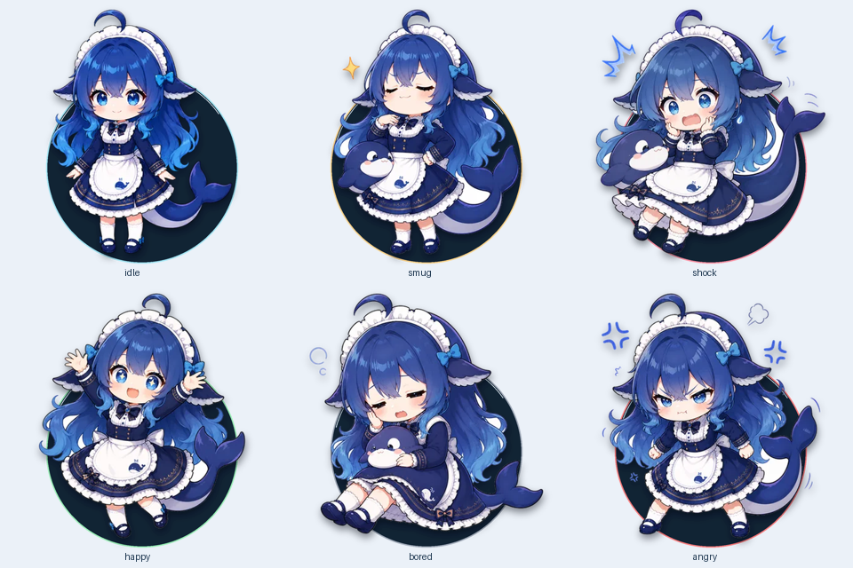

# dsh-whale-girl

macOS 上的看屏鲸鱼娘：截图 → 差分挑帧 → 九宫格 → DeepSeek 评论 → 气泡与本地 Qwen TTS。

Python 负责桌面、截图和音频；DSH 插件负责模型路由。默认每 2 秒采样，
收集明显变化的画面，最多 9 张拼成一张图发给模型。图片会离开本机，
发送到你配置的 DSH 模型服务；暂停时停止自动截图和新请求。



## 环境与安装

已验证：Apple Silicon macOS、Python **3.13.15**、Node **24.13.1**、
DSH **0.2.1-rc.2**、uv **0.13.6**、mlx-audio **0.5.0**。
Python 与 Node 版本分别记录在 `.python-version` / `.node-version`；
Python 的直接和传递依赖锁在 `uv.lock`，安装使用 `--frozen`。
TTS 为 Apple Silicon MLX 路线，未验证 Intel Mac、Windows 或 Linux。

```bash
git clone https://github.com/whyy9527/dsh-whale-girl.git
cd dsh-whale-girl
./scripts/setup.sh
npm install -g @deepseek-ai/dsh@0.2.1-rc.2
./scripts/install-plugin.sh
```

安装脚本创建项目自己的 `.venv`，包含桌面与 TTS 依赖，不依赖其他项目的 venv。
DSH 的 `web` profile 需已有支持图片输入的模型登录态。默认使用
`deepseek-official/deepseek-flash`；改模型/端口请编辑 `cordis.patch.yml` 并重装插件。
插件安装后重启 `dsh web`；端口监听成功时会自动拉起浮窗。

```bash
curl http://127.0.0.1:8791/health
```

本地克隆目录需保留：浮窗从安装的包目录调用 `scripts/run.sh`，并依赖该目录的 `.venv`。
本项目发布源码到 GitHub，不提供自带 Python/模型的应用安装包。

## 模型与音色分开准备

模型提供合成能力；参考音频与对应文字用于语音克隆，不需要每个音色下载一套模型。
本项目使用 Base 模型的 `ref_audio` / `ref_text` 条件。
参考音也可能影响语气、韵律和情绪，但不是独立的“情绪文件”。
六种 `mood` 目前只控制表情，不向 TTS 传递六套情绪指令。
详见 [Qwen 官方模型说明](https://huggingface.co/Qwen/Qwen3-TTS-12Hz-1.7B-Base)。

模型和参考音不随源码分发。下载固定版本模型：

```bash
.venv/bin/hf download mlx-community/Qwen3-TTS-12Hz-1.7B-Base-bf16 \
  --revision a6eb4f68e4b056f1215157bb696209bc82a6db48
```

提供你有权使用的干净短参考音（约 3 秒），并将音频里的**准确台词**保存成 UTF-8 文本文件。
用绝对路径创建符号链接；只链接，不复制模型或参考音：

```bash
.venv/bin/python scripts/link-tts.py \
  --model /absolute/path/to/model/snapshots/a6eb4f68e4b056f1215157bb696209bc82a6db48 \
  --reference-audio /absolute/path/to/reference.wav \
  --reference-text /absolute/path/to/reference.txt
```

运行时固定读取：

```text
~/.local/share/dsh-whale-girl/
  tts-model     -> 模型快照目录
  reference.wav -> 你提供的参考音
  reference.txt -> 参考音的准确台词
```

缺失时会明确报错；不会自动选择其他模型快照或偷偷切换云端音色。
换参考音即可换音色。模型仍是同一套。需要音色完全一致时，复现者必须提供同一段授权参考音。

## 运行与交互

首次截屏需要在「系统设置 → 隐私与安全性 → 屏幕录制」授权实际启动浮窗的终端/应用，
然后重开该程序。从 DSH 自动启动时，也需检查启动 DSH 的程序的授权。

```bash
./scripts/run.sh                 # 正常运行
./scripts/run.sh --check         # 检查插件、截图和真实 TTS 合成；失败返回非零
./scripts/run.sh --once          # 看一次，等语音结束后退出
./scripts/run.sh --demo --once   # 合成画面走通模型、气泡、语音，不截真实屏幕
./scripts/run.sh --preview '你好' # 只预览浮窗
./scripts/run.sh --restart       # 等旧实例释放锁后重启
./scripts/run.sh --stop          # 等浮窗完成退出
```

- 拖动头像：移动并保存位置。
- 单击/右键：现在看一眼、暂停/继续、打开配置文件夹、退出。
- 暂停：停止自动采样，清空待发批次、取消待播语音，丢弃暂停前的在途回复。
  暂停期间主动点“现在看一眼”仍会执行一次。
- 连续评论：只保留最新待播的一句；旧合成结果不会恢复播放，语音不会叠加。
- 退出：停止播放并回收本地 TTS 子进程。浮窗独立运行，DSH 重启不会主动关闭它。

## 配置

首次运行生成 `$DSH_HOME/whale-girl/config.json`，默认 `~/.dsh/whale-girl/config.json`。
日志与图片/音频缓存也在这个目录内，不进入源码仓库。

| 配置项 | 默认 | 作用 |
|---|---|---|
| `endpoint` | `http://127.0.0.1:8791` | DSH 插件 |
| `sampleIntervalSec` | `2` | 截图采样间隔 |
| `diffThreshold` | `0.035` | 64×36 灰度指纹的平均差阈值 |
| `batchSize` | `9` | 单批最多帧数，支持 1–9 |
| `maxBatchSec` | `60` | 已开始批次的最长等待 |
| `minSendIntervalSec` | `20` | 自动发送最小间隔 |
| `sendMode` | `grid` | `grid` 发一张拼图；`frames` 发独立 JPEG |
| `tts.enabled` | `true` | 是否说话 |
| `tts.engine` | `local` | 本地 Qwen；可显式设为 `cloud` |
| `tts.fallbackCloud` | `false` | 本地失败时是否允许云端音色 |
| `avatar.size` | `132` | 头像直径 |
| `bubbleHideAfterSec` | `12` | 气泡显示时间 |

帧差始终与上次保留的帧比较；发完批次后保留该基准。
已开始的批次即使只有一帧，静止超过 60 秒也会发出；之后如果画面一直不变，
不会周期性重复发相同截图。最小发送间隔内形成的完整批次会被跳过。
模型请求期间暂停采样，因此这不是连续录屏。

云端 TTS 可通过 `DASHSCOPE_API_KEY` 或显式 `tts.apiKey` 配置，
音色由 `tts.voice` 决定，与本地参考音不同。默认不会读取 shell 配置中的密钥。

## 换成本地表情

可以。右键头像 → **打开表情文件夹**，把图片拖进去，使用下面的文件名：

```text
~/.dsh/whale-girl/expressions/
  idle.png    # 待机
  smug.png    # 得意
  shock.png   # 惊讶
  happy.png   # 开心
  bored.png   # 困倦 / 无聊
  angry.png   # 生气
```

也支持同名 `.webp`；同一情绪同时存在 PNG/WebP 时，PNG 优先。
每种情绪独立选择：**本地图片优先，缺少的继续用内置系列**，不用一次凑齐六张。
运行中约 1 秒自动检查并刷新；拖动时延后到松手再加载。删除本地图会恢复该情绪的内置图。
自定义位置可改 `avatar.expressionsPath`；使用自定义 `DSH_HOME` 时，默认表情目录随它移动。
本地图片和缓存均在仓库外，不会被 Git 提交。

出框效果请使用**有透明背景的 RGBA PNG/WebP**：人物、头发、尾巴保持原样叠在圆底前，
并添加接触阴影。普通不透明图片按圆形头像显示，不自动去除背景。
这是一种分层的伪 3D 视觉效果，不会把原画重画成 3D 人物。

第一次更新到此版本需要重新启动浮窗；之后仅更换表情图片无需重启：

```bash
./scripts/run.sh --restart
```

## 六种表情与许可

`idle` / `smug` / `shock` / `happy` / `bored` / `angry` 来自同一套幼年鲸鱼娘素材。
原文件、上游版本与映射记录在 `assets/expressions/sources.json`，运行时生成圆底、阴影与透明人物出框的缓存。

代码使用 **MIT**；内置角色图片使用 **CC BY-NC-SA 4.0**，
需要署名、非商业使用、相同方式共享。图片不属于 MIT 范围。
完整来源链与模型许可见 [THIRD-PARTY-NOTICES.md](THIRD-PARTY-NOTICES.md)。
非官方同人项目，不代表 DeepSeek 官方。

个人原画、私人衍生表情、模型、参考音、配置、密钥和运行日志不在公开仓库中。

## 感谢与设计参考

感谢以下社区项目提供的功能与交互设计参考。前七项为本轮实际查阅的设计资料，
未复制其代码或角色图片；实际使用的图片来自最后一项，许可与署名链单独保留。
本项目使用自己的 PyObjC 浮窗、差分采样和本地 Qwen 语音实现。
下表记录具体参考维度，不以 star 数作为功能或稳定性的依据。

| 项目 | 参考之处 |
|---|---|
| [dsh-pet](https://github.com/PC2005-cloud/dsh-pet) | 透明桌宠、拖拽交互、可替换角色包的体验 |
| [dsh-pet-watch](https://github.com/learner202699/dsh-pet-watch) | 截屏 → 视觉短评 → 桌宠气泡的陪看链路 |
| [dsh-fish-buddy](https://github.com/Yuuyuko-uu/dsh-fish-buddy) | Python 桌面挂件与 DSH 插件两半的职责划分；未使用其受限图片 |
| [dsh-video-storyboard](https://github.com/SAOS-3624/dsh-video-storyboard) | 按时间组织编号画面、将多帧打包为一图的表达方式 |
| [dsh-vision-suite](https://github.com/princefrogdida-ux/dsh-vision-suite) | 本地截图差异比较的功能参考；本项目使用自己的低分辨率灰度指纹 |
| [dsh-watch-together](https://github.com/SAOS-3624/dsh-watch-together) | 陪看画面与声音的职责拆分、迟到语音不堆积的体验参考 |
| [dsh-live-narrator](https://github.com/yinque91/dsh-live-narrator) | 语音解说体验调研；帮助区分 agent 动作解说与本项目的屏幕视觉评论 |
| [keleus/deepseek-pet](https://github.com/keleus/deepseek-pet) | 实际使用的六种同系列幼年鲸鱼娘图片，完整署名链见第三方许可 |

## 验证

```bash
npm test
.venv/bin/python -m unittest discover -s tests -p 'test_*.py'
.venv/bin/python tests/smoke_macos.py
```

插件测试使用假模型起真 HTTP 服务；桌面测试验证编码、暂停、最新语音优先、实例锁、本地图片优先、热更新缓存和真实 Cocoa 拖拽坐标。
macOS smoke 实际启动 Cocoa 浮窗，验证重复启动、重启与空闲后 SIGTERM 退出；
它不截图、不调用模型。`--demo --once` 则会实际调用你配置的模型和 TTS。
